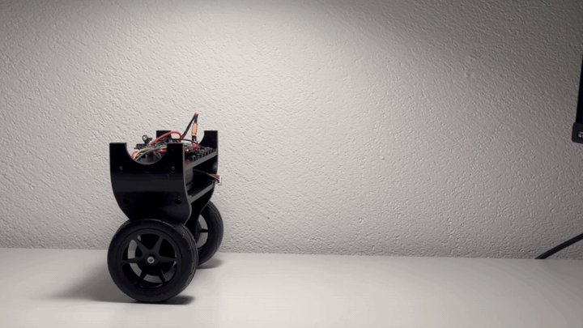
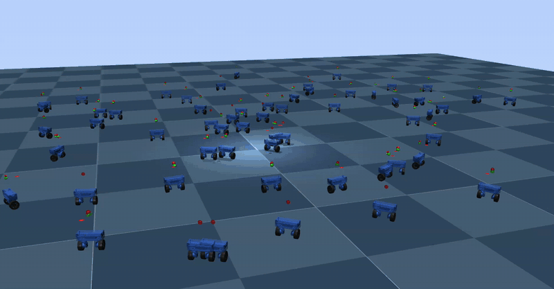
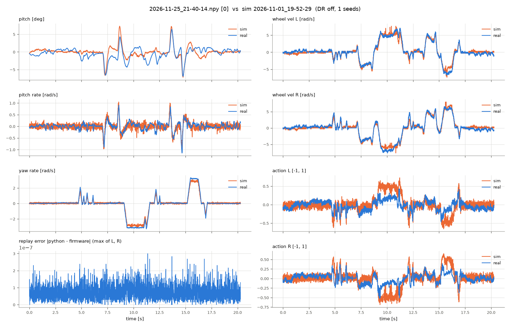
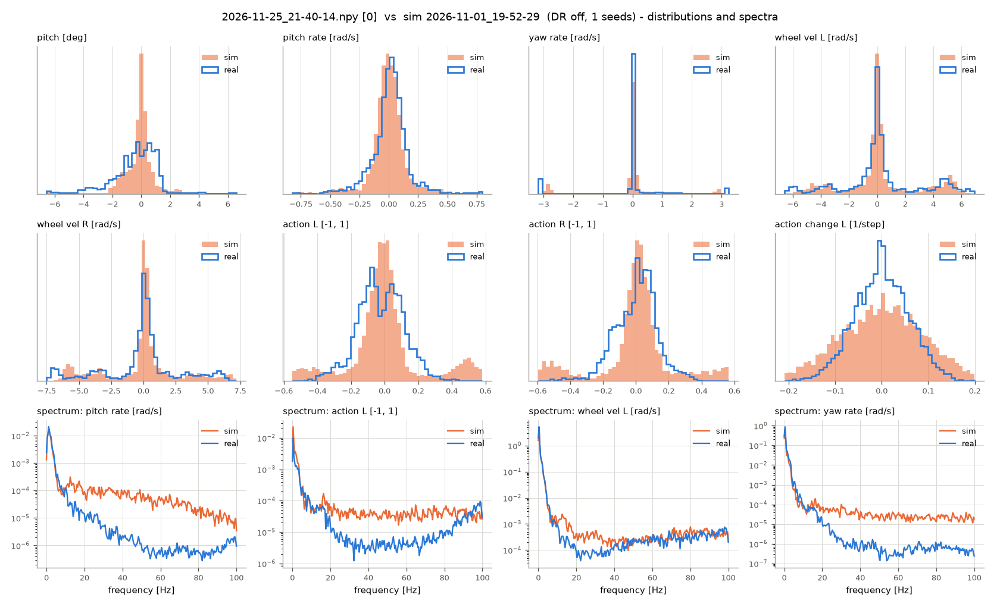

# balancebot sim2real

A two-wheeled self-balancing robot controlled by a neural network policy trained with reinforcement
learning in simulation and deployed on an ESP32-S3.

<p align="center">
  <br>
  <em>Driving, turning on the spot and recovering from pushes</em>
</p>

## Overview

- **Hardware**: ESP32-S3, two BLDC motors with SimpleFOC, wheel encoders, MPU6050 IMU.
- **Simulation**: MuJoCo model of the robot, a Gymnasium environment (`env.py`) and a GPU-parallel
  [mjlab](https://github.com/mujocolab/mjlab) task with the same observations and actions.
- **Training**: PPO with three backends: my own implementation (`ppo_agent.py`), Stable-Baselines3,
  and mjlab / rsl_rl (gpu).
- **Sim-to-real**: domain randomization (masses, CoM, friction, damping, motor torque, actuation delay,
  IMU bias and tilt), random pushes, encoder quantization.
- **Deployment**: the policy (9 → 128 → 128 → 2, tanh) is exported to a C header and runs on the
  robot at 200 Hz. Inputs are pitch, pitch rate, yaw rate, wheel velocities, the velocity / yaw rate
  command and the previous action; outputs are the two wheel torques.
- **Tools**: a web-based observer (live 3D twin, telemetry, driving, recording and replay) and a
  script that replays robot logs in the sim to measure the sim-to-real gap.

<p align="center">
  <br>
  <em>Training in Mujoco</em>
</p>

## Sim-to-real

`compare_real_sim.py` takes a telemetry log from the robot and runs the same policy in the sim, from
the same start pitch and with the same velocity / yaw rate commands. Below: a 20 s log with driving and
fast turns, against the nominal sim.

<p align="center">
  
</p>

- Wheel velocities and yaw rate are almost identical in the sim and on the robot, and the pitch
  transients during the maneuvers have the same size.
- In the fast turns (9–11.5 s, 15–16.5 s) the sim needs about twice the torque of the real robot.
- Replaying the logged network inputs through the Python policy reproduces the firmware's outputs to
  within 3e-7, so the exported weights, observation order and scaling match training.

<p align="center">
  
</p>

## Repository

```
RL_training/
  balancebot.xml, scene.xml, meshes/   MuJoCo model (robot + scene)
  env.py                               Gymnasium environment
  ppo_agent.py                         my PPO implementation
  train.py                             training entry point: algo = "my_ppo" | "sb3" | "mjlab"
  mjlab_task/                          mjlab task (environment and PPO config)
  export_weights.py                    any trained policy -> C header for the firmware
  evaluate.py                          standing, command tracking and push recovery tests in the sim
  robot_log.py                         records the robot's telemetry over WiFi
  compare_real_sim.py                  robot log vs. the same policy in the sim
Firmware/
  BalancingBot_Firmware/               PlatformIO firmware (policy, PID fallback, telemetry)
  SimpleFOC_test/                      motor bring-up test
Observer/                              web dashboard for the robot
```

## Quickstart

```bash
cd RL_training
python -m venv .venv && source .venv/bin/activate
pip install -r requirements.txt

python train.py                       # edit CONFIG at the top first
python evaluate.py runs/<run>         # test it in the sim (--render to watch)
python export_weights.py runs/<run> -o ../Firmware/BalancingBot_Firmware/weights/model.h
```

For `algo="mjlab"`, clone [mjlab](https://github.com/mujocolab/mjlab) next to this repository
(or set `MJLAB_DIR`); `train.py` links the task into it and runs the training with mjlab's own
environment.

Firmware (PlatformIO):

```bash
cd Firmware/BalancingBot_Firmware
cp include/wifi_config.example.h include/wifi_config.h   # optional, without it the robot opens its own WiFi
pio run -t upload
```

Observer: `cd Observer && pip install -r requirements.txt && python observer.py`, then open
http://localhost:8080 (see [Observer/README.md](Observer/README.md)).
